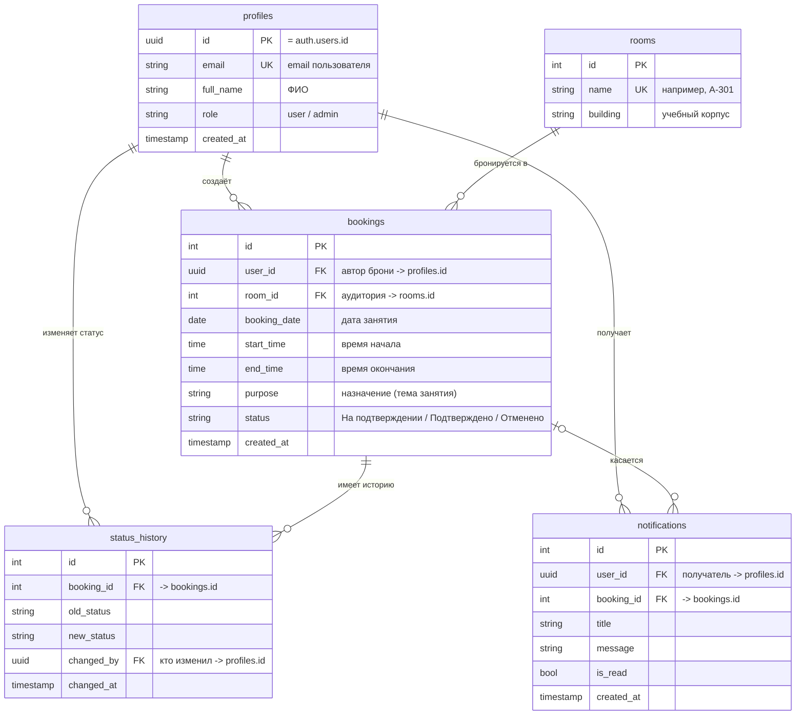
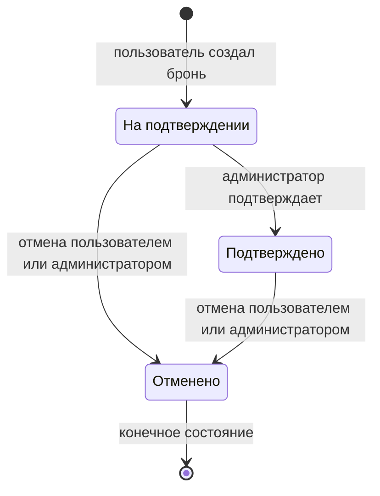

# RoomBook — бронирование учебных аудиторий

Веб-приложение для бронирования учебных аудиторий: студент или преподаватель создаёт бронь на нужную дату и время, система проверяет занятость аудитории и не даёт создать две брони на один слот, а администратор подтверждает или отменяет заявки и видит сводную аналитику.

[](https://nikita0968.github.io/roombook/)

-3ecf8e)


**Онлайн-демо:** https://nikita0968.github.io/roombook/

---

## О проекте

### Проблема

Без информационной системы бронирование аудиторий ведётся через устные договорённости, сообщения в мессенджерах или бумажный журнал. Из-за этого:

- невозможно быстро понять, свободна ли аудитория в нужное время;
- возникают **двойные брони**, когда две группы приходят в одну аудиторию;
- нет истории — кто, когда и на сколько забронировал помещение;
- отмена брони не фиксируется, и аудитория простаивает.

### Решение

RoomBook сводит это к понятному сценарию: пользователь видит список своих броней, создаёт новую, а система проверяет конфликт по времени, хранит историю изменения статусов и уведомляет пользователя в реальном времени.

---

## Возможности

- 🔐 **Регистрация и вход** через Supabase Auth (email + пароль, пароль не короче 6 символов).
- 🏛 **Список аудиторий** (А-301, А-302, Б-214, Б-215, В-101).
- 📅 **Создание брони** с валидацией: обязательные поля, «окончание позже начала», назначение не короче 5 символов.
- 🚫 **Проверка пересечений** — на одну аудиторию, дату и пересекающееся время нельзя создать две активные брони.
- 📋 **Список броней** с поиском, фильтром по статусу и карточкой брони.
- ⏱ **Отмена брони** пользователем и подтверждение/отмена администратором.
- 📆 **Календарь занятости** — получасовые слоты с 08:00 до 20:30, клик по занятому слоту открывает бронь.
- 📊 **Админ-панель** — показатели (всего/на подтверждении/подтверждено/отменено), графики по статусам и аудиториям (Chart.js), список всех броней и список пользователей.
- 🔔 **Уведомления в реальном времени** (Supabase Realtime) о смене статуса брони.
- 📜 **История изменений статусов** — таблица `status_history` хранит, кто и когда перевёл бронь в новое состояние.
- 🛡 **Row Level Security** — пользователь видит только свои брони, администратор — все.

---

## Роли

| Роль | Возможности |
| --- | --- |
| **Пользователь** | регистрация и вход, создание брони, список своих броней, карточка брони, отмена своей брони, уведомления |
| **Администратор** | всё перечисленное, плюс: все брони всех пользователей, подтверждение броней, удаление броней, админ-панель с аналитикой, список зарегистрированных пользователей и их профили |

Регистрация публично доступна только для роли «Пользователь»; роль `admin` назначается в базе данных.

---

## Технологии

| Слой | Технология |
| --- | --- |
| Frontend | HTML5, CSS3, чистый JavaScript (без фреймворков) |
| Backend / БД | Supabase: PostgreSQL, Auth, Row Level Security, триггеры, Realtime |
| Доступ к данным | Supabase JS SDK (v2, через CDN) |
| Графики | Chart.js |
| Запуск локально | VS Code + Live Server (или любой статический сервер) |
| Хостинг | GitHub Pages |

Стек выбран так, чтобы собрать работающее приложение с реальной базой данных и авторизацией без развёртывания собственного серверного бэкенда.

---

## Структура репозитория

```
roombook/
├── index.html              # разметка всех экранов (вход, регистрация, список, форма, карточка, календарь, админка)
├── app.js                  # вся логика: Supabase-клиент, валидация, CRUD броней, календарь, графики, уведомления
├── styles.css              # стили интерфейса
├── queries.sql             # проверочные SQL-запросы (WHERE, ORDER BY, JOIN, агрегаты, GROUP BY, RLS)
├── roombook-flask/         # ранняя версия бэкенда на Flask (Python), оставлена для истории
│   ├── .env.example        # пример переменных окружения
│   ├── requirements.txt    # Flask, supabase, psycopg2-binary, python-dotenv
│   └── app.py              # заготовка (пустая)
└── README.md
```

---

## База данных

Источник данных — облачный PostgreSQL в Supabase. Схема состоит из 5 таблиц: `profiles`, `rooms`, `bookings`, `status_history`, `notifications`.

### ER-диаграмма



### Таблицы

| Таблица | Назначение | Ключевые поля |
| --- | --- | --- |
| `profiles` | профили пользователей, связаны 1:1 с `auth.users` | `id` (PK), `email`, `full_name`, `role`, `created_at` |
| `rooms` | справочник аудиторий | `id` (PK), `name`, `building` |
| `bookings` | основной объект системы — бронирование | `id` (PK), `user_id` (FK), `room_id` (FK), `booking_date`, `start_time`, `end_time`, `purpose`, `status`, `created_at` |
| `status_history` | история изменения статусов брони | `id` (PK), `booking_id` (FK), `old_status`, `new_status`, `changed_by` (FK), `changed_at` |
| `notifications` | уведомления пользователю о событиях по его броням | `id` (PK), `user_id` (FK), `booking_id` (FK), `title`, `message`, `is_read`, `created_at` |

### Связи

| Связь | Тип | Правило |
| --- | --- | --- |
| `profiles` → `bookings` | 1 : N | один пользователь создаёт много броней |
| `rooms` → `bookings` | 1 : N | одна аудитория участвует во многих бронях |
| `bookings` → `status_history` | 1 : N | у брони есть история переходов статусов |
| `profiles` → `status_history` | 1 : N | изменение статуса привязано к автору действия |
| `profiles` → `notifications` | 1 : N | пользователь получает уведомления |
| `bookings` → `notifications` | 1 : N (опционально) | уведомление может ссылаться на бронь |

### Состояния брони



Допустимые переходы: «На подтверждении» → «Подтверждено», «На подтверждении» → «Отменено», «Подтверждено» → «Отменено». Обратные переходы запрещены: отменённую бронь нельзя вернуть в работу.

### Бизнес-правила

- Бронь создаётся только со статусом `На подтверждении`.
- Время окончания должно быть строго позже времени начала.
- На одну аудиторию, дату и пересекающееся время не может быть двух активных (не «Отменено») броней.
- Отменённую бронь нельзя изменить или подтвердить.
- Записи в `status_history` и `notifications` создаются на стороне базы (триггеры Supabase).
- RLS-политики разграничивают доступ: пользователь работает только со своими бронями, администратор — со всеми.

---

## Запуск локально

1. Клонировать репозиторий:

   ```bash
   git clone https://github.com/Nikita0968/roombook.git
   cd roombook
   ```

2. Открыть папку в VS Code и запустить `index.html` через расширение **Live Server** (или поднять любой статический сервер).

3. Приложение уже подключено к Supabase: `SUPABASE_URL` и `SUPABASE_ANON_KEY` указаны в начале `app.js`. Anon key — публичный, доступ к данным защищён политиками **Row Level Security**, поэтому его можно держать в клиентском коде.

4. Для своей базы данных: создайте проект в Supabase, примените миграции (таблицы из ER-диаграммы, триггеры, RLS-политики) и подставьте свои `URL` и `anon key` в `app.js`.

### Переменные окружения для Flask-версии

`roombook-flask/.env.example`:

```
SUPABASE_URL=
SUPABASE_ANON_KEY=
SUPABASE_SERVICE_KEY=
DATABASE_URL=
FLASK_SECRET_KEY=
ADMIN_EMAIL=
ADMIN_PASSWORD=
```

---

## Проверочные SQL-запросы

Файл [`queries.sql`](queries.sql) подтверждает корректность структуры БД и данных:

| # | Запрос | Что демонстрирует |
| --- | --- | --- |
| 1 | брони в статусе «На подтверждении» | `WHERE` |
| 2 | брони по дате и времени | `ORDER BY` |
| 3 | бронь + аудитория + email автора | `JOIN` трёх таблиц |
| 4 | общее количество броней | `COUNT` |
| 5 | количество броней по статусам | `GROUP BY` + агрегация |
| 6 | количество зарегистрированных пользователей | показатель админки |
| 7 | броней по аудиториям | топ загруженных аудиторий |
| 8 | брони за последние 7 дней | `now() - interval` |
| 9 | пересекающиеся активные брони | проверка бизнес-правила (пусто = правило работает) |
| 10 | история изменений статусов | `JOIN` с `status_history` |
| 11 | таблицы с включённым RLS | `pg_tables` |
| 12 | политики доступа | `pg_policies` |

---

## Критерии приёмки

- [x] приложение открывается без ошибок в консоли браузера;
- [x] регистрация создаёт пользователя в системе;
- [x] вход работает по email и паролю;
- [x] список броней загружается из базы данных;
- [x] некорректная форма не создаёт бронь и показывает ошибки под полями;
- [x] корректная бронь создаётся и сохраняется в базе;
- [x] бронь видна после перезагрузки страницы;
- [x] карточка открывается и показывает данные и статус;
- [x] пользователь видит только свои брони;
- [x] администратор видит все брони и может подтверждать;
- [x] админ-панель показывает показатели из базы данных;
- [x] пользователь не может открыть админку («Доступ только для администратора»).

---

## Автор

**Nikita0968** — [github.com/Nikita0968](https://github.com/Nikita0968)

Проект выполнен в рамках дисциплины «Основы инженерии программных систем».
